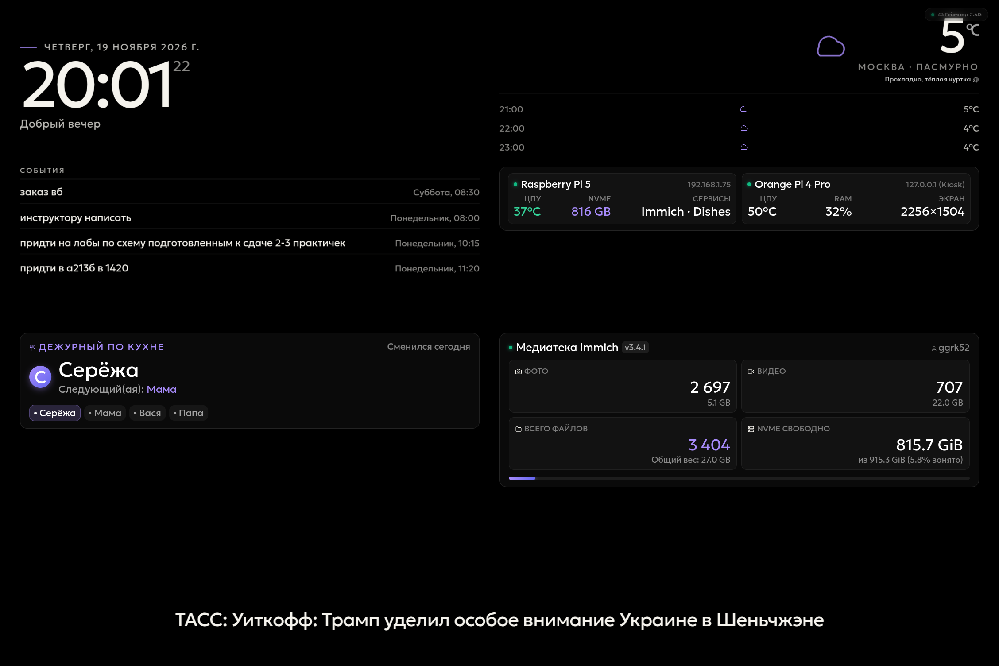

# Smart Dashboard

Интерактивный дашборд для одноплатных компьютеров (Orange Pi 4 Pro, Raspberry Pi 5) и внешних дисплеев (3:2 / 16:9).
Проект разработан для мониторинга домашней инфраструктуры, телеметрии серверов, отображения дежурств и погоды с поддержкой аппаратного управления через геймпад.



---

## Возможности

- **Телеметрия кластера:** Мониторинг состояния Raspberry Pi 5 и Orange Pi 4 Pro в реальном времени (температура процессоров, свободное место на NVMe, загрузка RAM, статусы доступности).
- **Статистика медиатеки Immich:** Сводка из личного облака фотографий (общее число фото и видео, занятый объем, остаток свободного пространства на сервере).
- **Трекер дежурства по кухне:** Синхронизация с микросервисом `dish-tracker` — текущий дежурный, история смен и очередь.
- **Погода (Met.no API):** Кэширующий прокси к метеосервису `api.met.no` без ограничений по геолокации, с прогнозом на сутки и адаптивными рекомендациями.
- **Синхронизация календаря:** Поддержка iCal-фидов и Google Calendar.
- **Новостная строка:** Адаптивная бегущая строка событий.
- **Поддержка геймпада (HTML5 Gamepad API):** 
  - Кнопка **A**: Принудительное обновление всех виджетов.
  - Кнопка **X**: Переключение между телеметрией серверов и финансовыми котировками.
- **Надежный режим Kiosk:** Запуск через Chromium с защитой от двойного запуска (`flock`), подавлением всплывающих окон и автовосстановлением после сбоев.

---

## Архитектура системы

```
+------------------------------------+          +------------------------------------+
|          Raspberry Pi 5            |          |          Orange Pi 4 Pro           |
| (Home Server, 192.168.1.75)        |          | (Display Client, 192.168.1.90)     |
+------------------------------------+          +------------------------------------+
| - Immich Server (:2283)            | <======> | - Node.js Backend (:3000)          |
| - Dish Tracker (:8080)             |  REST /  | - Chromium Kiosk (Display 3:2)     |
| - Beszel Agent (:8090)             |   JSON   | - 2.4G Gamepad Handler             |
| - NVMe 1TB Storage                 |          | - Met.no Weather Proxy Cache       |
+------------------------------------+          +------------------------------------+
```

---

## Быстрый запуск

### 1. Установка зависимостей
```bash
git clone https://github.com/ggrk52/smart-dashboard.git
cd smart-dashboard
npm install
```

### 2. Настройка переменных окружения
Создайте файл `.env` на основе шаблона:
```bash
cp .env.example .env
```
Заполните параметры вашей сети:
```ini
PORT=3000
MIRROR_PORT=3000
RPI_HOST=192.168.1.75
IMMICH_PORT=2283
IMMICH_API_KEY=your_key_here
DISH_PORT=8080
```

### 3. Запуск сервера
```bash
npm start
```

### 4. Автозапуск сервиса (Systemd)
```bash
sudo cp smart-dashboard.service /etc/systemd/system/
sudo systemctl daemon-reload
sudo systemctl enable --now smart-dashboard.service
```

### 5. Запуск режима Kiosk
Для запуска экрана в режиме полного экрана используется скрипт `scripts/start_kiosk.sh`.

---

## Лицензия

MIT License (c) 2026 ggrk52
